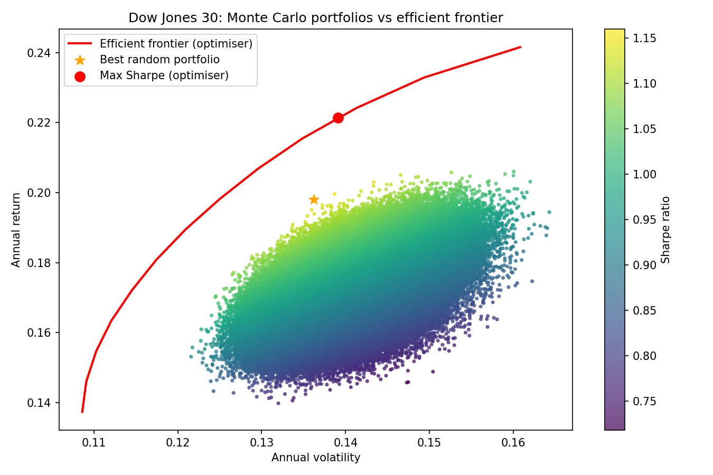

# Dow Jones 30: Monte Carlo portfolio optimisation

I first did this in Excel for an economics module at the University of Hong Kong: randomise portfolio weights, work out the risk and return of each one, and plot the efficient frontier. This is a rebuild in Python, with a proper optimiser and an out-of-sample test added on top.



## What it does

1. Downloads monthly prices for the 30 stocks in the Dow Jones (today's members) from January 2010, using `yfinance`. That gives 201 months of returns.
2. Works out each stock's average annual return and the covariance matrix between them.
3. Generates 500,000 random portfolios by drawing a random number for each stock and scaling so the weights add up to 100%. Each one is scored on return, volatility and Sharpe ratio (risk-free rate assumed at 4%).
4. Uses SciPy's optimiser (SLSQP) to solve for the true efficient frontier and the max-Sharpe portfolio. The optimiser is long-only and capped at 10% per stock.
5. Tests whether the optimised portfolios hold up on data they haven't seen.

## Results on the full sample

| Portfolio | Return | Volatility | Sharpe |
|---|---|---|---|
| Best of 500,000 random portfolios | 19.8% | 13.6% | 1.16 |
| Optimiser, max Sharpe (10% cap) | 22.1% | 13.9% | 1.30 |

Even with 500,000 tries, the random portfolios sit well below the frontier. With 30 stocks, random weights all end up looking like an equal-weighted portfolio (roughly 3-7% each), so it's almost impossible to land on the concentrated portfolios that make up the frontier.

## Out-of-sample test

I picked the weights using the first 150 months, then scored them on the last 51 months (roughly mid-2022 onwards), which the optimiser never saw. I compared against simply putting 1/30 in every stock.

| Portfolio | Return | Volatility | Sharpe |
|---|---|---|---|
| Max-Sharpe optimiser, in-sample | 22.8% | 13.8% | 1.37 |
| Max-Sharpe optimiser, out-of-sample | 15.1% | 14.5% | 0.77 |
| Min variance, in-sample | 13.9% | 10.4% | 0.95 |
| Min variance, out-of-sample | 10.6% | 12.6% | 0.52 |
| Equal weight, out-of-sample | 16.8% | 14.3% | 0.89 |

## What I found

-**The optimiser overfits.** Its Sharpe ratio dropped from 1.37 in-sample to 0.77 out-of-sample. It probably leaned on stocks that happened to do well in the first 150 months, and most of that edge disappeared on unseen data.
-**Equal weight is a tough benchmark.** Splitting the money evenly across all 30 stocks did best out-of-sample, beating both optimisers on Sharpe ratio. I wouldn’t claim it’s better in general, but it shows how hard it is to beat basic diversification.
-**Min variance did what it’s built to do, at a cost.** It had the lowest out-of-sample volatility (12.6%) but also the lowest return (10.6%). Its holdings at the 10% cap included defensive stocks like MRK, VZ, PG, WMT and MCD, which fits with it missing the run in tech. (Change this to a firmer statement once you’ve checked the weights.)
-**Risk wasn’t stable either.** It predicted 10.4% volatility and delivered 12.6%. Some of that gap is expected, since the optimiser picks whatever looks calmest on the training data, but it also suggests the correlations between stocks shifted.

## Limitations

- It's one train/test split with only 51 test months. A Sharpe ratio over that short a period is noisy, so the gaps between 0.52, 0.77 and 0.89 aren't strong evidence. The in-sample to out-of-sample drop is the clearest result.
- It uses today's Dow members, so every stock here has done well enough to get into the index. That flatters all the numbers (survivorship bias).
- The 10% cap is binding: several stocks sit at exactly 10%, so the "top holdings" among them are tied.
- The cap applies to the optimiser only, not to the random portfolios.
- No transaction costs, taxes or short selling, and the 4% risk-free rate is an assumption.

## Possible extensions

- Rolling-window testing (repeat the split at many points) to get a less noisy comparison.
- Methods that don't rely on noisy average returns, such as shrinking the estimates.

## How to run

```
pip install yfinance numpy pandas matplotlib scipy
python portfolio_monte_carlo.py
```
